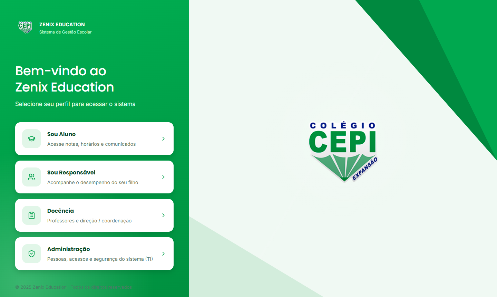
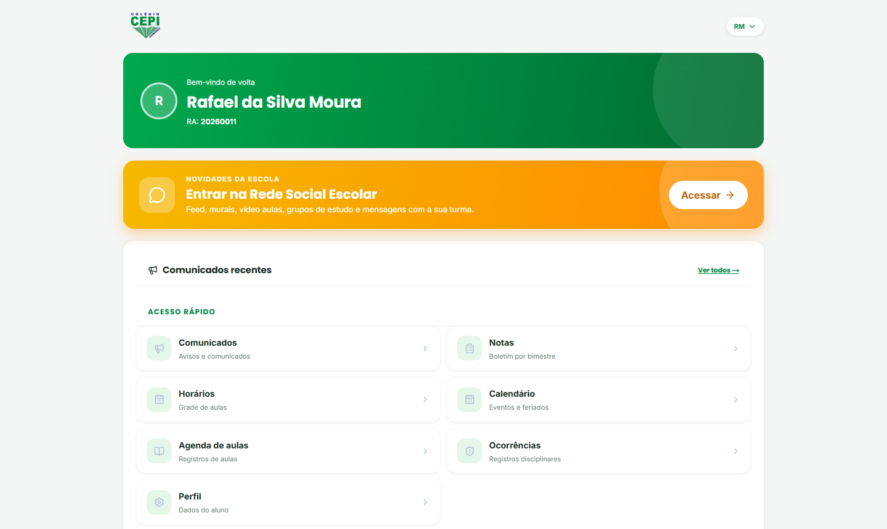
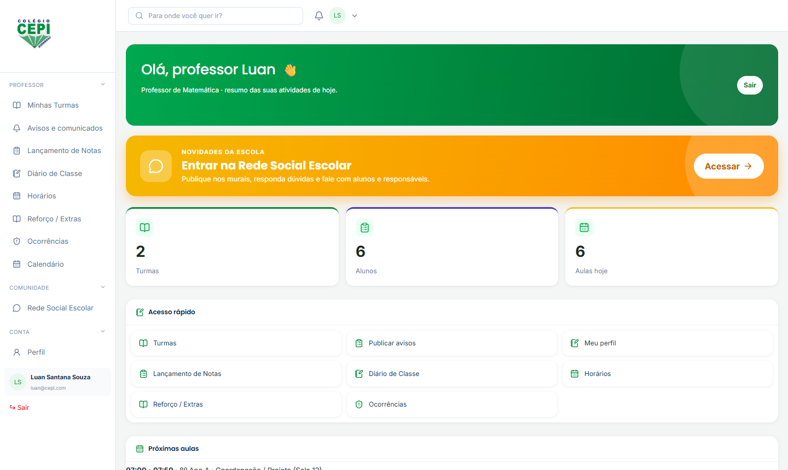
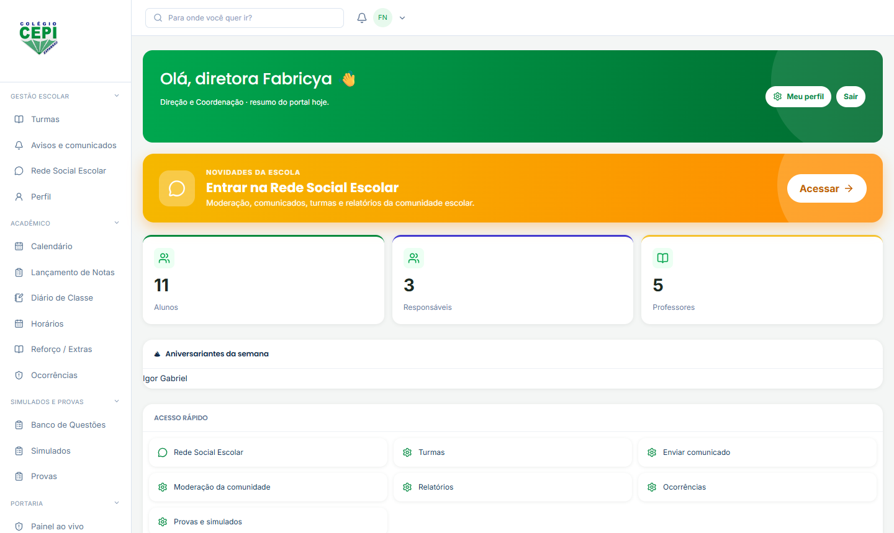
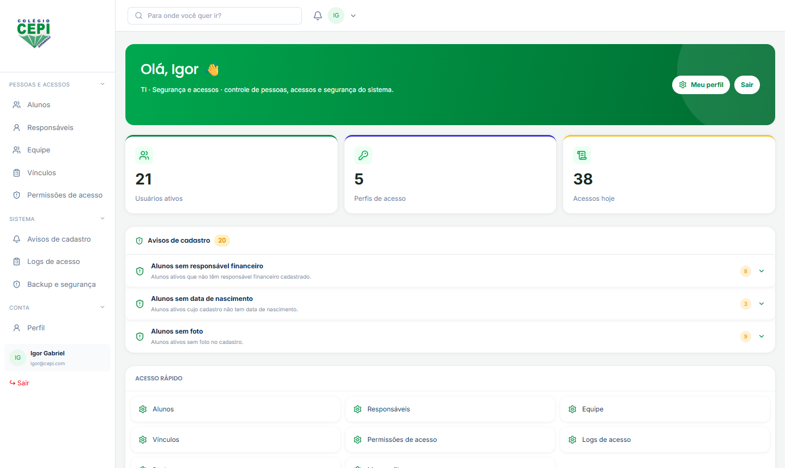
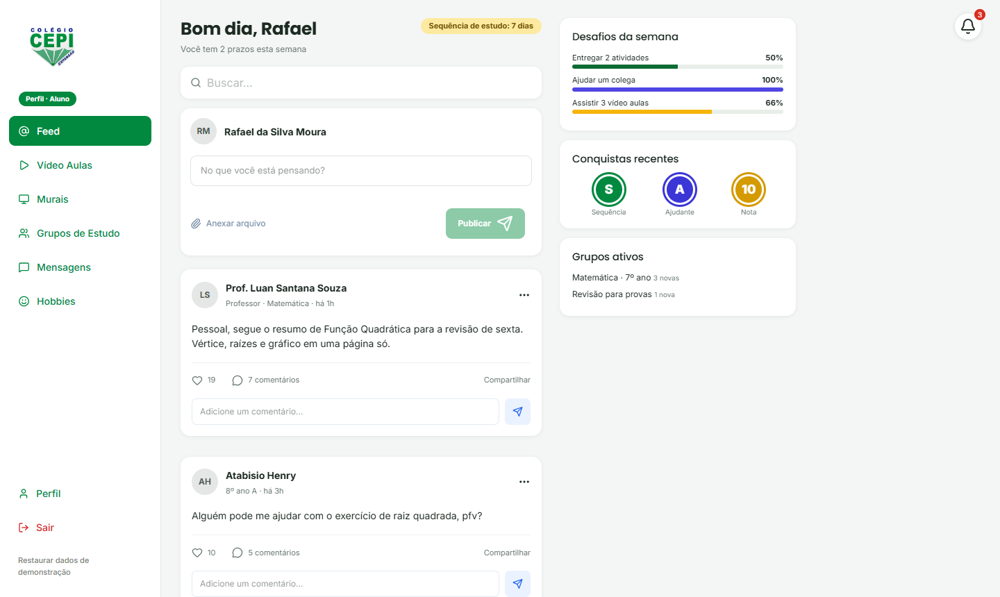
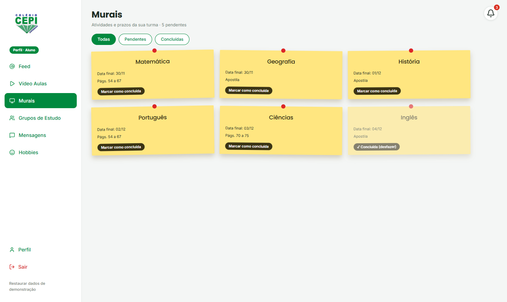
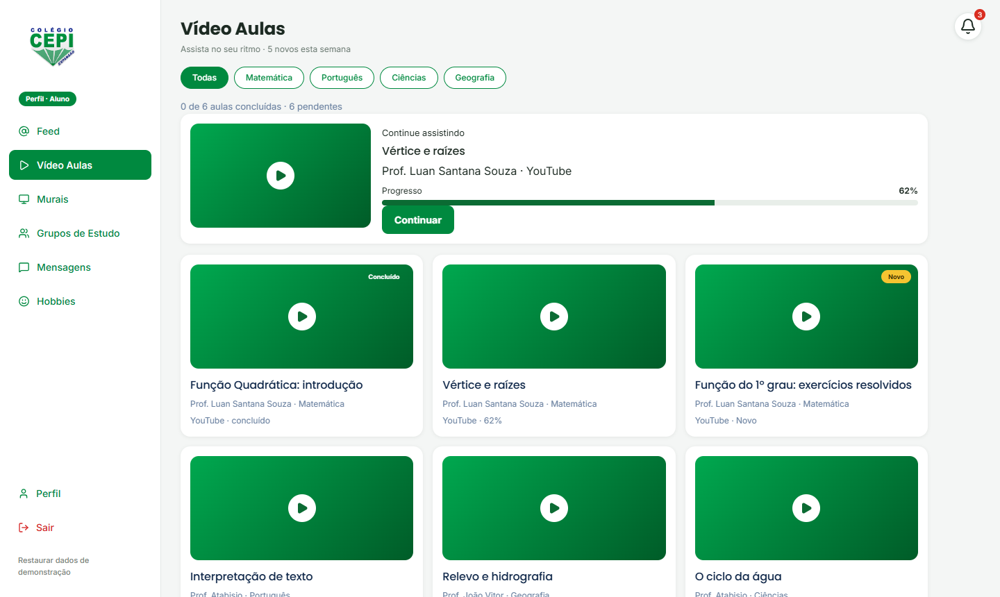
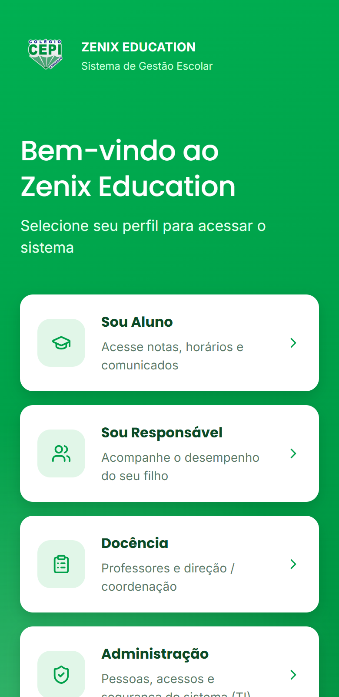
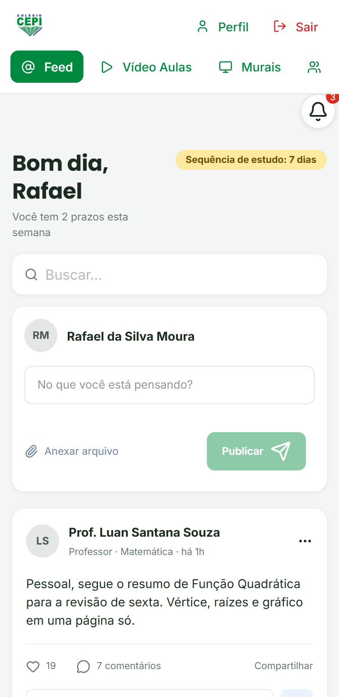

<div align="center">


# Zenix Education

### A plataforma escolar do Colégio CEPI Expansão: gestão, comunicação e uma rede social para toda a comunidade escolar.

[](https://squad42-cepi.vercel.app/)


<br />



</div>

---

## ✨ A ideia

Escola, famílias e professores costumam viver em ferramentas separadas: o aviso vai por um canal, a nota por outro, a conversa por um terceiro. A **Zenix Education** reúne tudo em um só lugar, com **um portal para cada perfil** e uma **rede social escolar** segura, pensada para aproximar quem faz a escola acontecer.

> 🎨 **O front-end foi inspirado nas telas desenhadas pelo grupo no Figma** (*CEPI Expansão — Plataforma*), mantendo a identidade verde do CEPI e um padrão visual único em toda a plataforma.

---

## 👥 Um portal para cada perfil

| Perfil | O que encontra |
|---|---|
| 🎓 **Aluno** | Notas por bimestre, horários, calendário, comunicados e a rede social |
| 👨‍👩‍👧 **Responsável** | Acompanhamento do filho, avisos da escola e conversa com professores |
| 📚 **Docência · Professor** | Turmas, lançamento de notas, diário de classe, ocorrências, reforço, banco de questões e simulados |
| 🏫 **Docência · Direção e Coordenação** | Visão geral da escola, comunicados, moderação, relatórios, provas e portaria |
| 🛡️ **Administração (TI)** | Cadastros, vínculos, permissões de acesso, logs, backup e segurança |

<div align="center">


<br />


</div>

---

## 💬 Rede Social Escolar

Uma comunidade própria da escola, com a cor e as permissões de cada perfil:

- **Feed** com publicações, curtidas e comentários
- **Murais** em formato de post-it, para recados e projetos de turma
- **Vídeo-aulas** com vídeos reais do YouTube, organizadas por disciplina
- **Grupos de estudo** e **hobbies** para criar e participar de comunidades
- **Mensagens** entre alunos, responsáveis, professores e coordenação
- **Moderação e relatórios** para a direção acompanhar a comunidade

<div align="center">


<br />

</div>

---

## 📱 Em qualquer dispositivo

O layout se adapta a **computador, tablet e celular**: o menu vira uma barra com abas, as tabelas viram cartões e nada fica cortado.

<div align="center">

&nbsp;&nbsp;&nbsp;

</div>

---

## 🔑 Teste agora

Acesse **https://squad42-cepi.vercel.app/**, escolha um perfil e clique em **Entrar**: o login já vem preenchido.

| Entrada | Pessoa e função | E-mail | Senha |
|---|---|---|---|
| Aluno | Rafael da Silva Moura | `rafael@cepi.com` | `rafael123` |
| Responsável | Fabricya Nayanne Santos (mãe de Rafael) | `fabricya@cepi.com` | `fabricya123` |
| Docência | Luan Santana Souza · Matemática | `luan@cepi.com` | `luan123` |
| Docência | João Vitor Braz Mourão · Geografia | `joao@cepi.com` | `joao123` |
| Docência | Atabisio Henry · Língua Portuguesa | `atabisio@cepi.com` | `atabisio123` |
| Docência (Direção) | Fabricya Nayanne Santos · Diretora | `fabricya.direcao@cepi.com` | `fabricya123` |
| Administração | Igor Gabriel · Segurança e acessos | `igor@cepi.com` | `igor123` |
| Administração | Yan Francisco Jesus de Oliveira · Infraestrutura | `yan@cepi.com` | `yan123` |
| Administração | Rafael da Silva Moura · Sistemas e cadastros | `rafael.ti@cepi.com` | `rafael123` |

> Versão de **demonstração**: os dados são fictícios e ficam salvos apenas no seu navegador. Há um botão **Restaurar dados de demonstração** no menu da rede social para recomeçar do zero.

---

## 🛠️ Tecnologias

**Next.js 16** (App Router) · **React 19** · **TypeScript** · **Tailwind CSS 4** · **lucide-react** · fontes **Inter** e **Poppins** · hospedagem na **Vercel**

## 🚀 Rodando localmente

```bash
git clone https://github.com/Nayanne38/squad42.git
cd squad42
npm install
npm run dev
```

Abra `http://localhost:3000` (requer Node.js 20 ou superior). Para testar no celular, use o endereço da sua rede, `http://IP-DO-SEU-PC:3000`.

```bash
npm run build && npm start   # versão de produção
```

**Publicar:** conecte o repositório à [Vercel](https://vercel.com) (*Add New → Project*). A cada `push` na `main`, uma nova versão é publicada automaticamente. Para domínio próprio, use *Settings → Domains*.

## 🗂️ Estrutura

```
app/            rotas e estilos globais
components/     telas por perfil (aluno, professor, administrador, ti, social, rede-social, shared)
data/shared/    dados de demonstração e contas de teste
lib/            sessão de demonstração e armazenamento local
public/         logo do CEPI e ícones
docs/img/       capturas de tela deste README
```

Mapa detalhado em [`MAPA_DO_PROJETO.md`](MAPA_DO_PROJETO.md).

## ⚠️ Sobre esta versão

É um **protótipo de front-end**: não há banco de dados, servidor próprio nem inteligência artificial. O login é demonstrativo, e logs, backup e recuperação de senha são simulados. Publicações, notas, comunicados e demais ações ficam no `localStorage` de cada navegador.

---

<div align="center">

**Squad 42** · Fabricya Nayanne Santos (líder) · Rafael da Silva Moura · Luan Santana Souza · João Vitor Braz Mourão · Atabisio Henry · Igor Gabriel · Yan Francisco Jesus de Oliveira

Feito com 💚 para o **Colégio CEPI Expansão**

</div>
